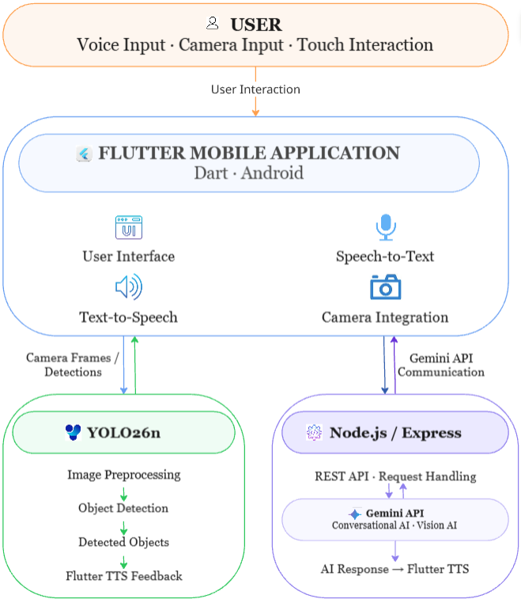
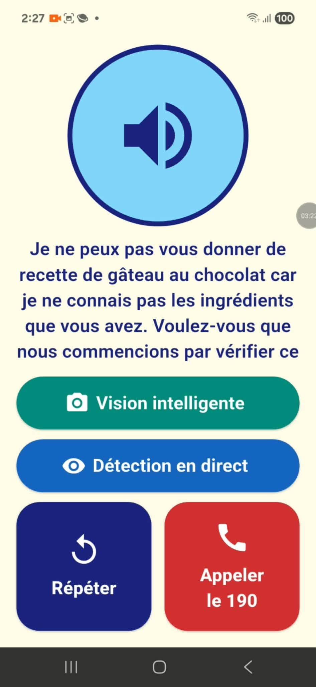
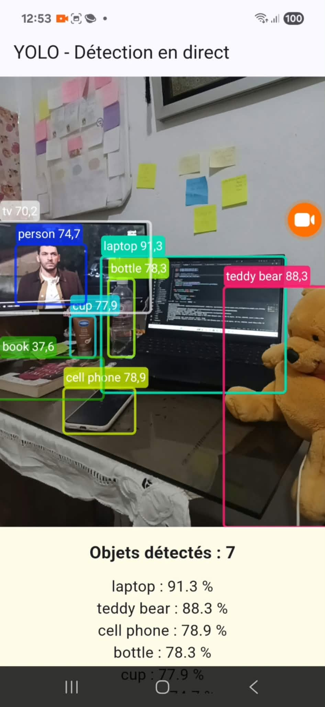
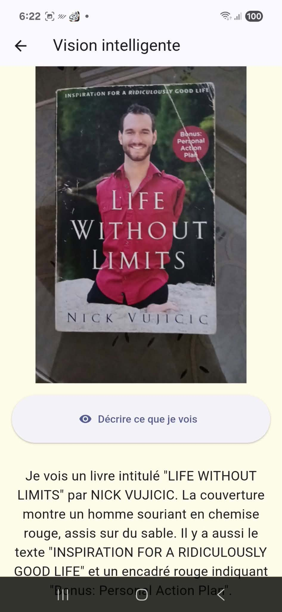
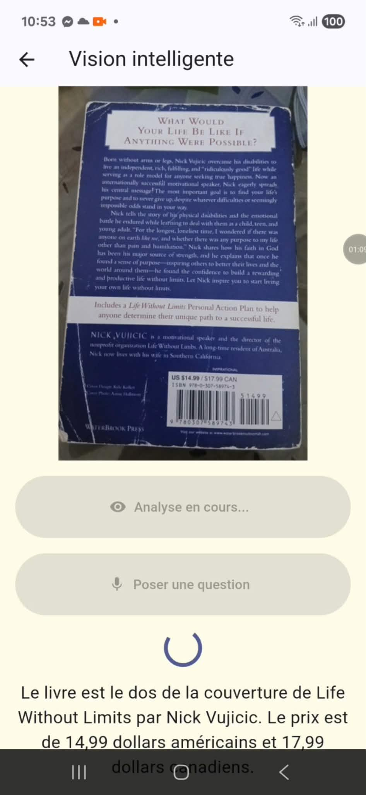

# 🦯 VisiWay — Your World, Through AI

**An AI-powered mobile application helping visually impaired users understand their surroundings through computer vision, voice interaction, and intelligent scene descriptions.**

## 1. Project Overview

**VisiWay** is an assistive mobile application developed with **Flutter**, integrating computer vision, speech technologies, and generative AI to help visually impaired users interact with and understand their surroundings.

The application combines **YOLO26n** for on-device object detection and **Google Gemini** for conversational assistance and image understanding.

## 2. Key Features

- **Voice Assistant:** Speech-to-Text (STT), Text-to-Speech (TTS), and AI-powered conversations.
- **Real-Time Object Detection:** Camera-based object detection using YOLO26n, with spoken feedback in French.
- **AI Scene Description:** Natural-language descriptions of images using Gemini Vision.
- **Accessible Interface:** Simple interactions designed to reduce reliance on visual navigation.

## 3. System Architecture

The application uses a hybrid architecture combining on-device AI and cloud-based intelligence.

- **On-device:** Flutter → Camera → YOLO26n → Detected Objects → Voice Feedback
- **Cloud-based:** Flutter → Node.js / Express → Gemini API → AI Response → Voice Output

### Architecture Diagram



## 4. Technologies Used

| Category | Technologies |
|---|---|
| Mobile Development | Flutter, Dart |
| Computer Vision | YOLO26n, Ultralytics YOLO |
| Generative AI | Google Gemini API |
| Backend | Node.js, Express.js |
| Voice Interaction | Speech-to-Text, Text-to-Speech |
| Development Tools | VS Code, Git, GitHub |

## 5. Project Structure

```text
canne-intelligente-ai-assistant/
├── android/
├── backend/
│   ├── server.js
│   └── package.json
├── lib/
│   ├── main.dart
│   ├── assistant_api.dart
│   ├── assistant_screen.dart
│   ├── voice_service.dart
│   └── vision/
│       ├── vision_api.dart
│       ├── vision_screen.dart
│       └── yolo_service.dart
├── pubspec.yaml
└── README.md
```

## 6. Getting Started

**Prerequisites:** Flutter SDK, Node.js, npm, Android device, and Google Gemini API key.

```bash
git clone https://github.com/farahchaabani1/canne-intelligente-ai-assistant.git
cd canne-intelligente-ai-assistant

# Install backend dependencies
cd backend
npm install

# Install Flutter dependencies
cd ..
flutter pub get
```

Configure the backend environment variables and mobile-to-backend connectivity before running the application. Keep API keys private.

```bash
flutter run
```

## 7. Demonstration

### Mobile Application

| Voice Assistant | Object Detection | Scene Description | Scene Description 2 |
|---|---|---|---|
|  |  |  |  |

### Demo Video

<!-- Replace the URL below with your actual demonstration video link -->

[Watch the Demo Video](assets/videos/Simulation.mp4)

## 8. Current Limitations

- Gemini-powered features require internet connectivity.
- Object detection performance depends on supported object classes.
- The application is a prototype.

## 9. Author

**Farah Chaabani**

Master's Student in Advanced Robotics and Artificial Intelligence.

**Interests:** Artificial Intelligence, Computer Vision, Applied AI, and Software Development.